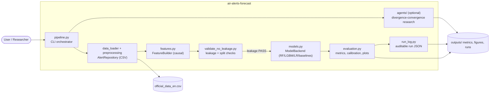

# Time Series Analysis of Air Raid Alerts in Ukraine

A reproducible research ML pipeline that forecasts the probability of a
**new** air-raid alert starting in a selected Ukrainian region (default:
**Kyiv City**) over a short horizon (default **30 minutes**).

> **This is NOT an early-warning system.** Air alerts reflect enemy decisions
> and air-defence actions, not natural cycles. Historical patterns do not
> guarantee future events. The goal is an honest, leakage-free research
> pipeline with baseline comparisons and clear limitations.

Inspired by Pavlyshenko & Pavlyshenko, *Predictive Analytics of Air Alerts in
the Russian-Ukrainian War* ([arXiv:2411.14625](https://arxiv.org/abs/2411.14625)).

**Project documentation:**
- [docs/TASK.md](docs/TASK.md) — описание задания Stage 2
- [docs/TECHNOLOGIES.md](docs/TECHNOLOGIES.md) — стек технологий и методологий
- [docs/C4.md](docs/C4.md) — C1/C2/C3 архитектура + научные ссылки

---

## 1. Methodology

### 1.1 Data

- **Source:** [Vadimkin/ukrainian-air-raid-sirens-dataset](https://github.com/Vadimkin/ukrainian-air-raid-sirens-dataset),
  file `official_data_en.csv`.
- **Schema (7 columns):** `oblast`, `raion`, `hromada`, `level`, `started_at`,
  `finished_at`, `source`.
- **Cleaning:** keep only `level == 'oblast'` (removes nested raion/hromada
  duplication), parse UTC timestamps, drop exact duplicates.
- **Date range:** 2022-03-15 → 2026-09-07.
- **Regions:** target Kyiv City; neighbors Kyivska, Chernihivska, Sumska
  oblasts.

### 1.2 Target definition

Regular 5-minute binary grid. For region *r* at time *t*:

```
y_t = 1  iff  a NEW alert starts in region r during (t, t + H]
```

H is configurable (15 / 30 / 60 minutes). The current cell *t* is excluded;
the last H cells are NaN (unobserved future).

### 1.3 Features (strictly causal — no leakage)

| Group | Features | Why no leakage |
|-------|----------|----------------|
| Lags (target) | 1, 5, 15, 30, 60, 180, 1440 min | `shift(k)`, k≥1 |
| Lags (neighbors) | same lags for each neighbor | `shift(k)`, k≥1 |
| Current alert | duration of active alert (min) | run-length of trailing 1s |
| Recency | time since last alert ended (min) | past only |
| Rolling counts | alert starts in last 1h, 6h, 24h, 7d | `shift(1).rolling(W).sum()` |
| Calendar | hour, dow, month, weekend, days since 2022-02-24 | deterministic(t) |
| Cyclic | sin/cos of hour and dow | deterministic(t) |

### 1.4 Split (chronological, no shuffling)

- **Train:** < 2024-01-01
- **Validation:** 2024-01-01 → 2024-06-30
- **Test:** ≥ 2024-07-01

Scaler, encoder, threshold — all fit **only on train/validation** respectively.
Threshold is selected on **validation** (maximize F1), never on test.

### 1.5 Models

1. **Persistence baseline** — if alert active at *t*, predict continuation.
2. **Seasonal baseline** — P(start | hour, dow) estimated on train.
3. **Logistic Regression** (class_weight=balanced)
4. **Random Forest** (class_weight=balanced)
5. **LightGBM** (scale_pos_weight)

### 1.6 Metrics

- **PR-AUC** (primary — severe class imbalance, ~2.8% positive rate)
- ROC-AUC, precision, recall, F1 (at val-selected threshold)
- Brier score, calibration curve, confusion matrix
- Lift over persistence baseline

---

## 2. Pipeline diagram

```
official_data_en.csv
        │
        ▼
[clean_intervals] ── filter oblast, parse, dedup
        │
        ▼
[build_binary_series] ── expand intervals → 5-min grid (0/1)
        │
        ├──────────────► [labels.make_target] ── y_t = 1 if new alert in (t, t+H]
        │
        ▼
[features.build_features] ── lags, rolling, calendar, cyclic (causal)
        │
        ▼
[chronological split] ── train / val / test
        │
        ▼
[models.fit_model] ── baselines + LR / RF / LightGBM; threshold on val
        │
        ▼
[evaluation] ── PR-AUC, ROC-AUC, F1, Brier, calibration, permutation
               importance, degradation-over-time, error examples
        │
        ▼
outputs/{figures,metrics,predictions}/
```

---

## 2.1 C4 Container diagram



Порты и адаптеры (Ports & Adapters) реализованы концептуально через модули:
`data_loader` → AlertRepository, `features` → FeatureBuilder, `models` → ModelBackend.
Полная C1/C2/C3 архитектура — в [docs/C4.md](docs/C4.md).

---

## 3. Results (Kyiv City, H=30 min)

| Model | PR-AUC | ROC-AUC | Precision | Recall | F1 | Brier | PR-AUC lift vs persistence |
|-------|--------|---------|-----------|--------|----|-------|----------------------------|
| persistence | 0.032 | 0.475 | 0.033 | 1.000 | 0.064 | 0.047 | 1.00× |
| seasonal | 0.035 | 0.517 | 0.034 | 0.123 | 0.053 | 0.032 | 1.07× |
| logistic_regression | 0.077 | 0.627 | 0.033 | 1.000 | 0.064 | 0.118 | **2.40×** |
| **random_forest** | **0.079** | **0.628** | 0.038 | 0.787 | **0.073** | 0.117 | **2.47×** |
| lightgbm | 0.043 | 0.539 | 0.043 | 0.160 | 0.067 | 0.055 | 1.33× |

**Best model:** Random Forest (PR-AUC 0.079, ~2.5× lift over persistence).
This is consistent with Pavlyshenko & Pavlyshenko who used Random Forest.

### Degradation over time (Random Forest)

| Window | Period | PR-AUC | F1 | Recall |
|--------|--------|--------|----|--------|
| 0 | 2024-07 → 2025-01 | 0.112 | 0.085 | 0.942 |
| 1 | 2025-01 → 2025-08 | 0.129 | 0.070 | 0.943 |
| 2 | 2025-08 → 2026-02 | 0.032 | 0.058 | 0.600 |
| 3 | 2026-02 → 2026-09 | 0.045 | 0.078 | 0.662 |

Clear non-stationarity: PR-AUC drops from ~0.13 to ~0.03 in later periods,
confirming that alert patterns change over time and the model degrades.

---

## 4. Limitations (honest discussion)

1. **Enemy-decision process, not a natural cycle.** Alerts are triggered by
   adversary actions and air-defence response. Historical patterns have
   limited extrapolation power.
2. **Non-stationarity.** Patterns shift over time (see degradation table).
   A model trained on 2022–2023 data degrades on 2025–2026.
3. **Class imbalance.** ~2.8% positive rate; F1 is low even for the best
   model. PR-AUC is the primary metric.
4. **No external signals.** No news, satellite, or military intelligence
   features — only past alert activity and calendar. Adding strictly
   timestamped external data (published before forecast time) could help.
5. **Single horizon benchmark.** Results shown for H=30 min; H=15/60 are
   configurable and may differ.

---

## 5. Project structure

```
air-alerts-forecast/
├── README.md
├── requirements.txt
├── config.yaml
├── Makefile
├── data/raw/                 # official_data_en.csv (not committed)
├── src/
│   ├── data_loader.py        # download + audit
│   ├── preprocessing.py      # clean + expand to binary series
│   ├── features.py           # causal feature engineering + split
│   ├── labels.py             # target construction
│   ├── models.py             # baselines + LR/RF/LightGBM
│   ├── evaluation.py         # metrics + permutation + degradation
│   ├── plots.py              # EDA + analysis figures
│   ├── validate_no_leakage.py # 23-check PASS/FAIL report
│   └── pipeline.py           # orchestrator (CLI)
├── docs/C4.md                # C1/C2/C3 architecture + references
├── tests/test_pipeline.py    # 8 unit tests
└── outputs/
    ├── figures/
    ├── metrics/
    └── predictions/
```

---

## 6. Quick start

### Run locally with pip

```bash
pip install -r requirements.txt

# End-to-end
make all

# Or stage by stage
make data          # download + audit + EDA plots
make features      # build features + target
make train         # fit all models, select threshold on val
make evaluate      # test metrics, calibration, importance, degradation

# Quality gates
make test                           # 8 unit tests
make validate-leakage               # 23 no-leakage checks
```

CLI usage:

```bash
python -m src.pipeline all --config config.yaml
python -m src.validate_no_leakage --config config.yaml
```

### Run with Docker

Docker uses a Python 3.11 multi-stage build and runs as a non-root user.
Build the image and run the same full pipeline:

```bash
docker build -t air-alerts-forecast:local .
docker run --rm \
  -v "$(pwd)/outputs:/app/outputs" \
  -e DATABASE_URL \
  air-alerts-forecast:local \
  python -m src.pipeline all --config config.yaml
```

The default image command prints pipeline CLI help. For a fast deterministic
end-to-end check, use `make smoke` locally or run
`python -m src.pipeline all --config config.smoke.yaml`; it uses the committed
small fixture and writes `outputs/metrics/smoke_metrics.json`.

`docker-compose.yml` is optional and only starts a local PostgreSQL service for
database integration testing; it does not start the application:

```bash
docker compose --profile db-test up -d postgres
```

The CI workflow runs lint, tests, leakage validation, Docker build and Docker
smoke test. Its end-to-end checks use only the fixed smoke fixture. It does not
publish images or deploy the application.

---

## 7. Configuration (`config.yaml`)

Key parameters:

```yaml
regions:
  target: "Kyiv City"
  neighbors: ["Kyivska oblast", "Chernihivska oblast", "Sumska oblast"]
time:
  freq_minutes: 5          # grid resolution
  horizon_minutes: 30      # forecast horizon H (try 15, 30, 60)
split:
  train_end: "2024-01-01"
  val_end: "2024-07-01"
threshold:
  metric: f1               # or "recall" with min_recall: 0.70
```

---

## 8. No-leakage guarantees (verified by `validate_no_leakage.py`)

- [x] Train < Validation < Test by timestamp, no overlap
- [x] All lag features match past values (no future fill)
- [x] No NaN / Inf in feature matrix
- [x] Target computed correctly: y_t = 1 iff new alert in (t, t+H]
- [x] No target column in features
- [x] Features and target share aligned index

See [docs/C4.md](docs/C4.md) for the full architecture and scientific references.

## 9. Optional Neon persistence

The pipeline works without PostgreSQL: raw downloads and generated dense
minute-level matrices remain local, with matrices stored as Parquet. Neon is
used only for raw alert events, cleaned intervals, experiment metadata, and
data-quality checks. See `sql/schema.sql` for the PostgreSQL DDL.

The versioned SQL migrations are in `sql/migrations/`. Apply them in order to
an empty Neon branch or local test database before the first persisted run:

```bash
psql "$DATABASE_URL" -v ON_ERROR_STOP=1 -f sql/migrations/001_initial_persistence.sql
psql "$DATABASE_URL" -v ON_ERROR_STOP=1 -f sql/migrations/002_upgrade_legacy_schema.sql
```

Migration 002 upgrades the earlier schema without deleting its data; old run
rows are copied to the current `experiment_runs` table and retained in
`experiment_runs_legacy_archive`. `sql/seeds/test_seed.sql` contains synthetic,
idempotent rows for a disposable local database or dedicated Neon test branch
only. Do not run it against production data.

To enable it, copy `.env.example` to `.env` and set `DATABASE_URL` to a Neon
connection string. The SQLAlchemy repository ensures its tables exist on
startup and uses `(region_id, alert_start, source)` plus `ON CONFLICT DO NOTHING`
for repeatable event loads. Experiment runs store one row per model, including
the raw-data SHA-256 as `dataset_version`. Never commit `.env` or credentials. Without a URL the
pipeline logs offline mode and continues using the local Parquet workflow.

The PostgreSQL integration test is opt-in. For local runs, point `DATABASE_URL`
at a disposable database or a dedicated Neon branch and set
`RUN_DB_TESTS=true`. In GitHub Actions, configure `TEST_DATABASE_URL` to a
separate Neon branch and `RUN_DB_TESTS=true` only when you want the integration
test enabled; the default CI run skips database tests.
