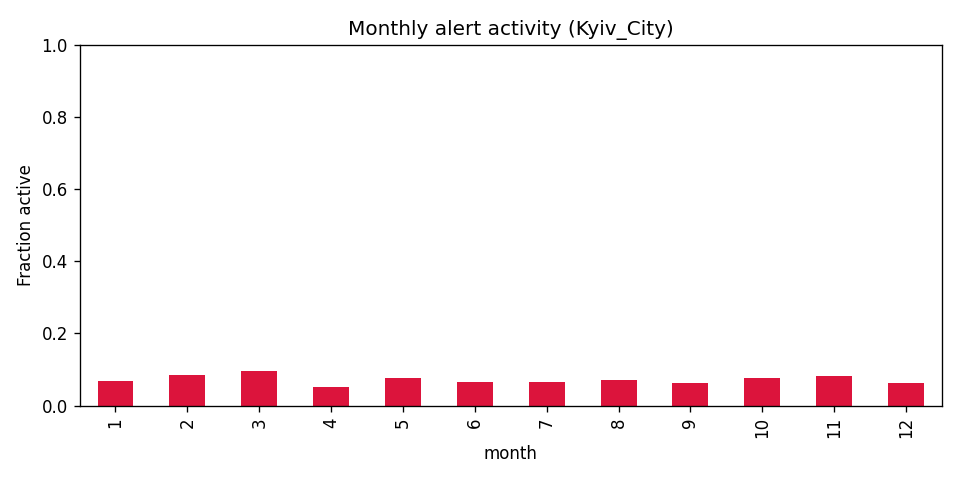
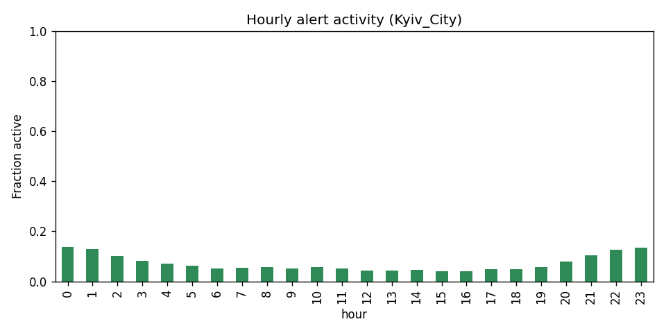
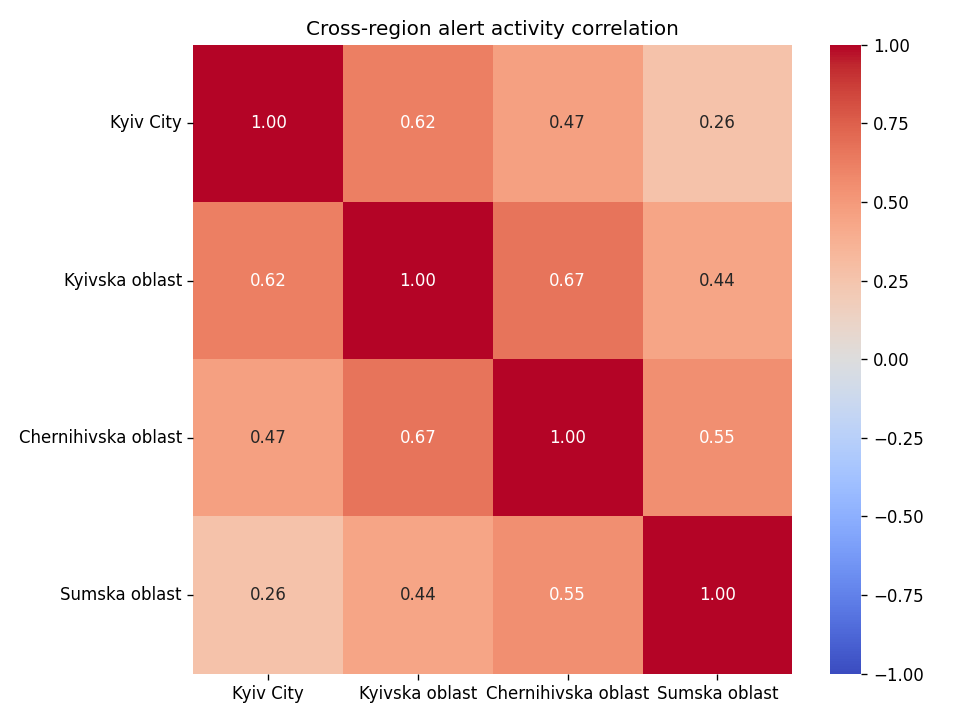
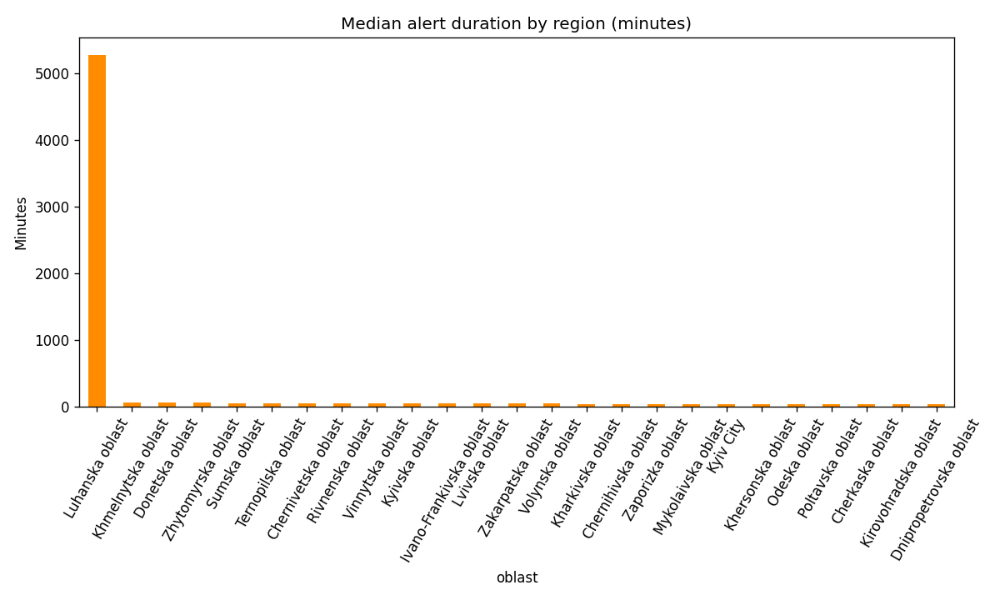
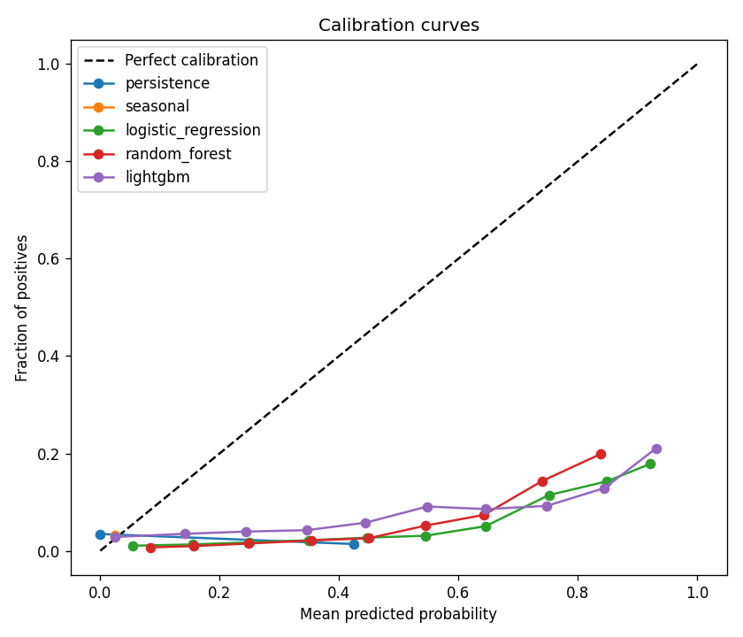
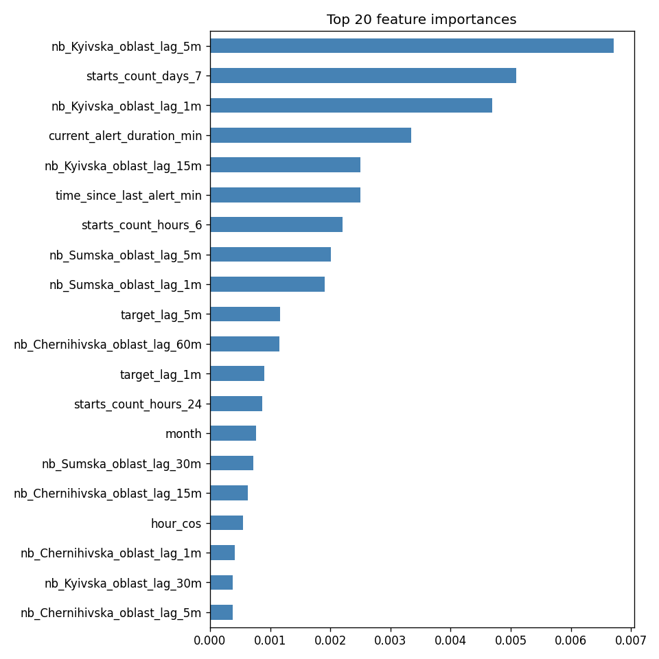

# Forecasting Air-Raid Alert Onsets in Ukraine

A reproducible research project that estimates whether a new air-raid alert will begin in Kyiv City within the next 30 minutes. It uses historical alert intervals, causal time-series features, chronological validation, and baseline and machine-learning models.

> **Research prototype only. This is not an early-warning or public-safety system.** Follow official Ukrainian air-alert channels and civil-protection instructions.

## Objective

For region r, timestamp t, and horizon H, the target is 1 when a new alert starts during (t, t + H], and 0 otherwise. H defaults to 30 minutes. Features may use observations available at or before t only.

## Method

- Raw source: the public [Ukrainian air-raid siren dataset](https://github.com/Vadimkin/ukrainian-air-raid-sirens-dataset), file official_data_en.csv.
- The source contains interval records at oblast, raion, and hromada levels. The modelling series retains oblast-level intervals and expands them to a regular five-minute grid.
- Features include past-only lags, rolling alert-onset counts, current alert duration, time since the previous alert, calendar variables, and lagged activity in neighboring regions.
- Train, validation, and test are chronological and non-overlapping. The classification threshold is selected on validation data only.
- PR-AUC is the primary metric because positive alert-onset windows are relatively rare.

See [the methodology](docs/methodology.md) for the target definition, leakage controls, evaluation design, and interpretation of figures.

## Selected exploratory figures

These plots are generated by the data stage and saved in outputs/figures. They show the questions the analysis is designed to answer: how alert activity changes over time, how regions co-vary, and what the baseline model can and cannot explain.

### Monthly activity in Kyiv City

### Hour-of-day activity in Kyiv City

### Correlation between regional alert series

### Alert durations by region

### Calibration and feature diagnostics

The current evaluation is a single chronological train/validation/test holdout. The test-period degradation table divides that holdout into four chronological chunks; it is **not** rolling-origin backtesting. A rolling-origin evaluation and a model-comparison PR-AUC figure are possible extensions and are not claimed as completed.

## Current holdout results

Results below come from the full dataset run recorded in outputs/metrics/test_metrics.json. The test base rate is about 3.28%; interpret thresholded metrics alongside this imbalance and the high false-positive rates.

| Model | PR-AUC | ROC-AUC | Precision | Recall | F1 | Brier score |
|---|---:|---:|---:|---:|---:|---:|
| Persistence | 0.032 | 0.475 | 0.033 | 1.000 | 0.064 | 0.047 |
| Seasonal | 0.035 | 0.517 | 0.034 | 0.123 | 0.053 | 0.032 |
| Logistic regression | 0.077 | 0.627 | 0.033 | 1.000 | 0.064 | 0.118 |
| Random forest | **0.079** | **0.628** | 0.038 | 0.787 | **0.073** | 0.117 |
| LightGBM | 0.043 | 0.539 | 0.043 | 0.160 | 0.067 | 0.055 |

The random forest has the highest PR-AUC in this run, at roughly 2.47 times the persistence PR-AUC. Its precision is still low, and the thresholded false-positive rate is high. This is a retrospective benchmark, not evidence of reliable future warning.

## Run locally with pip

~~~bash
python -m venv .venv
source .venv/bin/activate
pip install -r requirements.txt

# Full project pipeline (downloads the configured historical source if needed)
make all

# Small, deterministic end-to-end check
make smoke

# Tests and leakage validation
make test
make validate-leakage
~~~

On Windows, activate the virtual environment with .venv\Scripts\Activate.ps1.

## Run with Docker

The image uses a Python 3.11 multi-stage build and runs as a non-root user.

~~~bash
docker build -t air-alerts-forecast:local .
docker run --rm \
  -v "$(pwd)/outputs:/app/outputs" \
  -e DATABASE_URL \
  air-alerts-forecast:local \
  python -m src.pipeline all --config config.yaml
~~~

The image's default command displays CLI help. For a small container smoke run:

~~~bash
docker run --rm air-alerts-forecast:local sh -c \
  'python -m src.pipeline all --config config.smoke.yaml && test -s outputs/metrics/smoke_metrics.json'
~~~

The optional docker-compose profile starts only a local PostgreSQL service for persistence testing:

~~~bash
docker compose --profile db-test up -d postgres
~~~

CI runs Ruff, pytest, leakage validation, Docker build, and a Docker smoke test against the fixed small fixture. It does not push images or deploy the application.

## Optional Neon persistence

When DATABASE_URL is absent, the project runs offline and keeps data and dense matrices in local files. When configured, PostgreSQL stores raw events, cleaned intervals, data-quality checks, and experiment metadata; minute-level matrices remain in Parquet. Apply the SQL migrations in order before using a database. See [the architecture and persistence documentation](docs/architecture.md) and the [SQL test seed](sql/seeds/test_seed.sql). Never commit real credentials.

## Documentation

- [Methodology](docs/methodology.md)
- [Data card](docs/data_card.md)
- [Model card](docs/model_card.md)
- [Architecture and persistence](docs/architecture.md)
- [Stage 2 assignment summary](docs/TASK.md)
- [Technical stack](docs/TECHNOLOGIES.md)
- [Behavioral specification](SPEC.md)
- [C4 architecture and references](docs/C4.md)

The AI conversation export and the short reflection are separate submission artifacts; do not replace the full conversation export with a summary in this repository.
