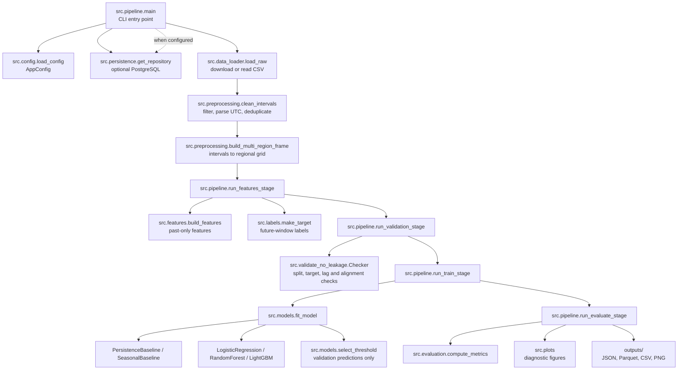

# C4 Architecture Documentation — Air Alerts Forecast

> Reproducible ML pipeline for short-horizon forecasting of air-raid alert
> starts in Ukrainian regions. Built as a research/educational pet-project,
> NOT an early-warning system.

---

## C1 — Context

```
┌──────────────────────────────────────────────────────────────────────┐
│                         AIR ALERTS FORECAST                          │
│                                                                      │
│   ┌──────────────┐     historical alert intervals     ┌────────────┐ │
│   │  Researcher  │ ─────────────────────────────────► │  Pipeline  │ │
│   │  (analyst)   │                                    │  (Python)  │ │
│   └──────────────┘ ◄───────────────────────────────── └────────────┘ │
│                          metrics, figures, predictions              │
│                                                                      │
│                          ┌──────────────────────────┐               │
│                          │ Vadimkin/ukrainian-air-   │               │
│                          │ raid-sirens-dataset       │               │
│                          │ (official_data_en.csv)    │               │
│                          └──────────────────────────┘               │
└──────────────────────────────────────────────────────────────────────┘
```

**Actors:**
- **Researcher / ML engineer** — runs the pipeline, inspects metrics and plots.

**External systems:**
- **Vadimkin/ukrainian-air-raid-sirens-dataset** — public GitHub repository
  with `official_data_en.csv` (oblast/raion/hromada alert intervals from the
  Ukrainian official alert system).

**Goal:** Predict the probability that a **new** air-raid alert starts in a
selected region (default: Kyiv City) within the next H minutes (default 30).

**In scope:** Binary classification on a regular 5-minute grid; features from
past alert activity and calendar; comparison of baseline and ML models;
honest evaluation with strict no-leakage guarantees.

**Out of scope:** Real-time inference, causal attribution of enemy decisions,
operational early-warning deployment, text/news features (optional future
extension only).

---

## C2 — Container

```
air-alerts-forecast/
│
├── [Container: Data Adapter]  src/data_loader.py
│     • downloads official_data_en.csv (HTTP)
│     • loads raw intervals (pandas)
│     • data-quality audit
│
├── [Container: Preprocessing] src/preprocessing.py
│     • retain oblast + raion rows; drop hromada
│     • assign district events to parent oblast; union overlaps
│     • parse timestamps, drop exact duplicates
│     • expand intervals → regular binary series (5 min grid)
│
├── [Container: Feature Engineering] src/features.py
│     • lags (target + neighbors), rolling counts
│     • current-alert duration, time-since-last
│     • calendar + cyclic (sin/cos) features
│     • chronological split with label-horizon embargo
│
├── [Container: Label Builder] src/labels.py
│     • y_t = 1 iff new alert starts in (t, t+H]
│
├── [Container: Model Factory] src/models.py
│     • Persistence, Seasonal baselines
│     • Logistic Regression, Random Forest, LightGBM
│     • scaler fit on train only; threshold on val only
│
├── [Container: Evaluation]   src/evaluation.py
│     • PR-AUC (primary), ROC-AUC, F1, Brier, calibration
│     • permutation importance, degradation-over-time, error examples
│
├── [Container: Visualization] src/plots.py
│     • EDA plots (counts, durations, hourly/weekly/monthly,
│       cross-region correlation, inter-alert intervals, yearly patterns)
│     • calibration curves, feature importance
│
├── [Container: Leakage Guard] src/validate_no_leakage.py
│     • checks: split chronology, lag past-only, no NaN/Inf,
│       target correctness, no target in features
│
├── [Container: Orchestrator]  src/pipeline.py
│     • CLI stages: data | features | train | evaluate | all
│
├── config.yaml               # Pydantic-validated configuration
├── Makefile                  # make data|features|train|evaluate|all|test
├── tests/                    # unit and opt-in PostgreSQL integration tests
├── Dockerfile                # Python 3.11 multi-stage image, non-root runtime
└── sql/                      # PostgreSQL schema, migrations, test seed
```

All containers run in a single Python process; data flows in-memory between
them. Artifacts (figures, metrics, predictions) are persisted to `outputs/`.

---

## C3 — Component (key modules)

The pipeline can run without a database. When DATABASE_URL is configured,
the optional persistence adapter stores raw alert events, cleaned intervals,
data-quality checks, and one experiment row per model. Dense minute-level
matrices remain local Parquet files.

### src/data_loader.py
| Function | Responsibility |
|----------|----------------|
| `download_if_needed` | HTTP GET of CSV; cache locally |
| `load_raw` | Read CSV into DataFrame |
| `audit_data_quality` | Schema, missing, duplicates, preview |
| `infer_time_columns` | Heuristic detection of timestamp columns |

### src/preprocessing.py
| Function | Responsibility |
|----------|----------------|
| `clean_intervals` | Retain oblast/raion rows, group by parent oblast, parse times, deduplicate same-level intervals |
| `build_region_binary_series` | Merge overlapping intervals, expand to grid |
| `build_multi_region_frame` | Wide frame for target + neighbors |

### src/features.py
| Function | Responsibility | No-leakage property |
|----------|----------------|----------------------|
| `add_lag_features` | `series.shift(k)`, k≥1 | past only |
| `add_rolling_alert_counts` | `shift(1).rolling(W).sum()` | past window |
| `add_current_alert_duration` | run-length of trailing 1s | past+present |
| `add_time_since_last_alert` | elapsed since last 0→1 | past only |
| `add_calendar_features` | hour, dow, month, sin/cos | deterministic(t) |
| `split_train_val_test` | chronological cutoffs | no shuffle |
| `split_labeled_train_val_test` | chronological partitions + full-horizon purge | label windows stay within their partition |

### src/labels.py
| Function | Responsibility |
|----------|----------------|
| `alert_starts` | 0→1 transition indicator |
| `make_target` | forward sum over (t, t+H]; NaN tail |

### src/models.py
| Class/Function | Responsibility |
|----------------|----------------|
| `PersistenceBaseline` | active→predict 1; prob≈base rate |
| `SeasonalBaseline` | P(start \| hour, dow) from train |
| `build_sklearn_model` | LR / RF / LightGBM instances |
| `select_threshold` | max F1 (or recall≥0.70) on val |
| `fit_model` | fit, scale-on-train, threshold-on-val |

### src/evaluation.py
| Function | Responsibility |
|----------|----------------|
| `compute_metrics` | PR-AUC, ROC-AUC, F1, Brier, CM, lift |
| `calibration_curve` | reliability diagram bins |
| `compute_permutation_importance` | model-agnostic importance |
| `degradation_over_time` | metrics per chronological window |
| `error_examples` | TP/FP/TN/FN timestamps |

---

## C4 — Code (code-level view)

The C4 Code level zooms into a component from C3 and shows how its source-code elements collaborate. This project is primarily function- and module-based, so the view below maps the main pipeline functions and model classes rather than inventing a class hierarchy. It is a navigational overview; the Python source remains authoritative.



### Code-level responsibilities

| Code element | Role |
|---|---|
| `src.pipeline.main` | Loads configuration and coordinates the selected pipeline stages. |
| `src.data_loader` and `src.preprocessing` | Read the source CSV, clean intervals, and build regional activity series. |
| `src.features` and `src.labels` | Build causal model inputs and the forward-looking evaluation target separately. |
| `src.validate_no_leakage.Checker` | Runs deterministic checks before model fitting. |
| `src.models.fit_model` | Fits a baseline or ML estimator, then selects its classification threshold from validation predictions. |
| `src.pipeline.run_evaluate_stage` | Scores the held-out test data and writes metrics and diagnostics. |
| `src.persistence` | Optionally stores compact source records and experiment metadata; dense matrices remain in Parquet files. |

**Scope note:** The pipeline purges training and validation rows whose forward label windows reach the next split. The primary benchmark remains a single chronological holdout; its four degradation chunks are not rolling-origin backtesting.

---

## Key scientific references

| Publication | Relevance to this project |
|-------------|---------------------------|
| Pavlyshenko & Pavlyshenko, *Predictive Analytics of Air Alerts in the Russian-Ukrainian War*, [arXiv:2411.14625](https://arxiv.org/abs/2411.14625) | Closest work. Minute binary series, EDA, inter-region correlations, lags, Random Forest. Predicts alert start in next 5 min. Confirms neighbor regions and temporal features matter; patterns are non-stationary. |
| Danz et al., *Public response to government alerts saves lives during Russian invasion of Ukraine*, PNAS 2023 | Context: alerts trigger fast population response; timely warnings have measurable protective value. |
| Krelinova, Loktieva & Jusselme, *Forecasting Displacement and Solutions for Decision-Making in Volatile Contexts: A Case Study from Ukraine*, Cambridge 2025 | Example of forecasting in volatile conflict settings. |
| *Forecasting Russian Equipment Losses Using Time Series Models*, [arXiv:2509.07813](https://arxiv.org/abs/2509.07813) | TCN/LSTM/Prophet for conflict time series; neural nets can give stable short-horizon forecasts. |
| *An Open-Source Tool for Mapping War Destruction at Scale*, [arXiv:2406.02506](https://arxiv.org/abs/2406.02506) | Methodological reference for before/after temporal window control. |

**Dataset:** [Vadimkin/ukrainian-air-raid-sirens-dataset](https://github.com/Vadimkin/ukrainian-air-raid-sirens-dataset) — `official_data_en.csv`.
